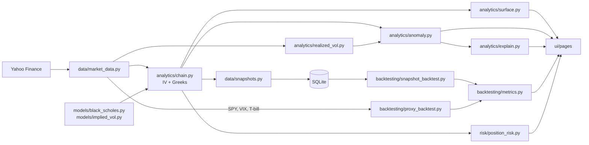

# Options Volatility Research Platform

A research and education tool that asks one question about listed stock options:

> **Are some options unusually expensive or cheap compared with what their recent market behavior would suggest?**

It downloads live option chains, solves each option's implied volatility with a from-scratch Black-Scholes implementation, compares implied volatility with realized volatility and with neighboring options, flags potential anomalies, explains them in plain English, and tests simple trading rules historically **after transaction costs**.

It does **not** place trades, and nothing here is investment advice.

---

## Contents

1. [Project overview](#1-project-overview)
2. [Why this project exists](#2-why-this-project-exists)
3. [Architecture](#3-architecture)
4. [Technologies](#4-technologies)
5. [Financial concepts](#5-financial-concepts)
6. [How implied volatility works](#6-how-implied-volatility-works)
7. [How anomaly detection works](#7-how-anomaly-detection-works)
8. [Backtesting methodology](#8-backtesting-methodology)
9. [Risks and limitations](#9-risks-and-limitations)
10. [Installation](#10-installation)
11. [Screenshots](#11-screenshots)
12. [Future improvements](#12-future-improvements)
13. [What I learned](#what-i-learned)

---

## 1. Project overview

| Section | What it shows |
|---|---|
| **Market Overview** | Spot price, ~30-day at-the-money IV, realized volatility (10/20/30/60 days), IV/RV ratio, rolling realized-vol chart |
| **Options Chain** | Searchable chain with bid/ask/mid, volume, open interest, Yahoo's IV vs. our IV, a liquidity flag with the reason, and a contract panel with market price, Black-Scholes price at realized vol, IV and Greeks, each explained in a sentence |
| **IV vs Realized** | Implied vs. historical volatility bars, rule-based interpretation, ATM term structure, and IV history from collected snapshots |
| **Volatility Surface** | Heatmap (expirations × strikes), smile curves, optional 3D surface |
| **Anomaly Scanner** | 0-100 *Volatility Anomaly Score* per option, smile chart vs. neighbor trend, rule-based and optional AI explanations |
| **Trade Simulator** | What-if P&L for a hypothetical trade with fills at bid/ask, costs, and payoff charts |
| **Backtest** | Walk-forward backtest on collected real quotes, plus a clearly labeled *modeled* SPY + VIX backtest with gross vs. net P&L, baseline comparison and a sensitivity grid |
| **Risk** | Position Greeks in dollars, theoretical and simulated maximum loss, stock × volatility stress grid, backtest drawdown |
| **Methodology** | Every formula, assumption and limitation |

### Data provenance is always labeled

| Label | Meaning |
|---|---|
| `LIVE` | Current quotes from Yahoo Finance (delayed, may be stale outside market hours) |
| `COLLECTED` | Real option-chain snapshots this app downloaded on earlier days and stored in SQLite |
| `MODELED` | Option prices computed with Black-Scholes from SPY prices and the VIX index. **Not** historical option quotes |

The app never fabricates market data, backtest results or metrics. When data is missing it says so.

## 2. Why this project exists

Option prices are mostly a bet on one unknown: how much the underlying will move. The market's estimate of that is **implied volatility (IV)**. What the stock actually did is **realized volatility (RV)**. The difference between the two, and the way IV varies across strikes and expirations, is the raw material of volatility trading.

This project was built to understand that material from first principles, and to be honest about the gap between a signal that looks interesting and a trade that would actually make money after costs.

## 3. Architecture

```
app/
├── main.py                 Streamlit entry point: sidebar, top bar, navigation
├── config.py               Every assumption in one place (filters, costs, weights)
├── data/
│   ├── market_data.py      The ONLY file that talks to Yahoo Finance
│   ├── repository.py       The ONLY file that talks to SQLite (swap for Postgres here)
│   ├── schema.sql          Tables, each with a provenance column
│   ├── snapshots.py        Daily option-chain collection
│   └── synthetic.py        Synthetic data for automated tests only
├── models/
│   ├── black_scholes.py    Prices and Greeks, written from the formulas
│   └── implied_vol.py      IV solver with no-arbitrage checks
├── analytics/
│   ├── chain.py            Mid, spread, moneyness, liquidity, IV, Greeks per contract
│   ├── realized_vol.py     Historical volatility
│   ├── surface.py          Surface grid, term structure, IV history
│   ├── anomaly.py          Volatility Anomaly Score
│   ├── interpret.py        Rule-based IV-vs-RV sentences
│   └── explain.py          Explanation fact sheets, optional LLM, number verification
├── backtesting/
│   ├── costs.py            Spread, slippage, fees, hedge costs
│   ├── metrics.py          Win rate, returns, drawdown, Sharpe
│   ├── snapshot_backtest.py  Walk-forward on collected quotes
│   └── proxy_backtest.py   Modeled SPY + VIX backtest
├── risk/position_risk.py   Position Greeks, scenarios, max loss
├── ui/                     Theme, components, explanations ("learn"), one file per page
└── utils/                  Dates, provenance labels
scripts/collect_snapshot.py Daily data collection (run on a schedule)
tests/                      197 tests, no network needed
```



Design rule: **data never touches math, math never touches UI.** Every calculation is a plain function that can be tested without Streamlit or the internet.

## 4. Technologies

- **Python 3.10+**
- **Streamlit** for the web app, **Plotly** for interactive charts
- **pandas / NumPy** for data handling, **SciPy** (`brentq`) for the IV root-finder
- **yfinance** for free market data (delayed, no SLA)
- **SQLite** through a repository layer (portable to PostgreSQL)
- **Anthropic API** (optional) for natural-language explanations, with numeric verification
- **pytest** and GitHub Actions for tests

## 5. Financial concepts

| Concept | One-line meaning |
|---|---|
| Call / put | Right to buy / sell 100 shares at the strike before expiry |
| Bid / ask / mid | Best buy price / best sell price / halfway point |
| Moneyness | Strike ÷ spot. Out-of-the-money options are mostly time value |
| Realized volatility | Annualized standard deviation of daily log returns: `std × √252` |
| Implied volatility | The volatility that makes Black-Scholes equal the market price |
| Greeks | Delta (stock), Gamma (delta's sensitivity), Vega (volatility), Theta (time) |
| Volatility smile / skew | IV differs by strike; equity downside puts usually carry higher IV |
| Term structure | IV differs by expiration; earnings create bumps |
| Variance risk premium | IV tends to exceed subsequent realized vol, because option sellers bear crash risk |
| Delta hedging | Offsetting an option's stock exposure with shares, to isolate volatility |

**Black-Scholes (with dividend yield q):**

```
d1 = [ln(S/K) + (r − q + σ²/2)·T] / (σ·√T)        d2 = d1 − σ·√T
Call = S·e^(−qT)·N(d1) − K·e^(−rT)·N(d2)
Put  = K·e^(−rT)·N(−d2) − S·e^(−qT)·N(−d1)
```

Assumptions: constant volatility, log-normal prices without jumps, constant rates, frictionless trading, European exercise. Each one is violated in practice, which is why the surface is not flat and why costs matter.

## 6. How implied volatility works

1. Take the bid/ask **midpoint** as the market price (Yahoo's last trade can be stale).
2. Check no-arbitrage bounds: a call must be worth between `max(S·e^(−qT) − K·e^(−rT), 0)` and `S·e^(−qT)`. Prices outside those bounds cannot be produced by any volatility.
3. If the price is within half a cent of intrinsic value, there is no time value to read a volatility from, so no IV is reported.
4. Otherwise solve `BlackScholes(σ) = mid` with **Brent's method** between 0.01% and 500%. Because price rises monotonically with σ, there is exactly one answer, and a bracketing method cannot diverge (unlike Newton's method when vega is tiny).
5. Every failure gets a status (`below_intrinsic`, `no_time_value`, ...) instead of a fake number.

Tests price options across 120 combinations of type, strike, maturity and volatility and check that the solver recovers the input volatility (or correctly reports that there is no time value to solve from), and reproduce Hull's textbook example (IV ≈ 23.5%).

## 7. How anomaly detection works

Only **liquid, out-of-the-money** options with a solved IV are scored (bid ≥ $0.05, spread ≤ 35% of mid, open interest ≥ 50, ≥ 3 days to expiry).

For each option, three comparisons become robust z-scores:

| Component | Weight | Compared with |
|---|---|---|
| Nearby strikes | 55% | A straight trend line through up to 3 strikes on each side (self excluded), read at this strike. The line respects skew, so edge strikes are not unfairly flagged |
| Neighboring expirations | 30% | Smile *shape* (IV minus ATM IV) at the same moneyness in the adjacent expirations' smoothed smiles, so one outlier does not create a mirror-image flag next door |
| Rest of chain | 15% | log(IV ÷ 30-day RV) vs. all scored options |

```
z     = difference / max(1.4826 × MAD, 0.5 vol points)
score = 100 × min(weighted mean of |z| / 4, 1)
```

The **median absolute deviation (MAD)** is used instead of the standard deviation because the standard deviation is inflated by the very outliers we are looking for. A score of 100 means a combined 4-sigma outlier.

Two honest notes:
- Realized volatility is the same number for every option on a stock, so it cannot rank options against each other. The IV − RV gap is displayed for context but carries little weight.
- A flag is a **potential volatility anomaly**: earnings, dividends, hard-to-borrow stock, early exercise or a stale quote can all explain it.

**Explanations.** Each flag gets a deterministic, rule-based explanation. Optionally an LLM rewrites the same facts. The model only sees a fact sheet of numbers the app computed, and its answer is scanned: if it contains any number that is not in the fact sheet, the AI text is rejected and the rule-based text is shown with a note. AI text is always labeled.

## 8. Backtesting methodology

Free data has no history of option prices. Rather than invent one, the project runs two clearly separated backtests.

### A. Collected snapshots (`COLLECTED`, real quotes)

`scripts/collect_snapshot.py` stores every contract for the chosen tickers once per trading day, together with the inputs known at that moment (spot, rate, dividend yield, 30-day RV). The backtest then walks forward:

1. On each snapshot day, score anomalies using **only that day's stored rows**.
2. Sell the top "rich" options / buy the top "cheap" ones (max 3 per day), optionally delta-hedged once at entry.
3. Exit 5, 10 or 20 business days later at that day's stored quote.
4. Trades without a clean exit quote are listed as **unresolved**, never estimated.

This backtest starts empty and becomes meaningful only after weeks of daily collection.

### B. Modeled proxy (`MODELED`, SPY + VIX)

The VIX index is the market's 30-day implied volatility for the S&P 500, computed by Cboe from real SPX options. Every *h* trading days:

1. `premium = VIX/100 − 20-day realized vol of SPY` (closes up to and including that day only).
2. If `premium ≥ threshold`, sell a 30-day at-the-money SPY straddle priced with Black-Scholes at VIX, delta-hedged at entry. (Optional: buy when premium ≤ −threshold.)
3. Re-price at exit with the new SPY price, the new VIX and the remaining time.

Results are always shown next to an **always-sell baseline** (does the signal add anything?) and across a **full sensitivity grid** of 3 holding periods × 5 thresholds, so no favorable setting is cherry-picked.

### No look-ahead

Enforced by construction and tested: `tests/test_backtest.py` truncates the data, or injects a fake future crash, and asserts that every earlier decision is unchanged.

### Costs (Phase 9)

```
Net P&L = Gross P&L at mid
        − half the bid/ask spread on entry and on exit
        − slippage (10% of the spread per fill)
        − $0.65 per contract per fill
        − $0.01 per share for the stock hedge
```

The modeled backtest has no real quotes, so it assumes a spread of 2% of the option price. All cost assumptions are editable in the app.

### Metrics

Number of trades, win rate, average return on premium, total P&L, maximum drawdown, annualized Sharpe ratio, worst trade, each shown **gross and net**. P&L is booked at exit, so in-trade swings are not marked: drawdown is understated and Sharpe is optimistic, and the app says so.

## 9. Risks and limitations

- Free, delayed data; quotes outside market hours are often stale or zero (filtered, not fixed).
- European Black-Scholes on American options; continuous dividend yield instead of discrete dividends.
- Anomaly flags are hypotheses. Most real ones have mundane explanations.
- The modeled backtest prices options at VIX, which typically sits a few points above at-the-money IV and therefore **overstates** short-volatility premium. There is no term structure, no skew, a static hedge, and assumed costs. A "Subtract from VIX" control tests sensitivity.
- Short-volatility strategies tend to show steady gains with rare, large losses; small samples hide this.
- Simulated results are hypothetical and are not actual investment returns.

## 10. Installation

```bash
git clone https://github.com/devjanyani/options-vol-research
cd options-vol-research
python -m venv .venv
source .venv/bin/activate          # Windows: .venv\Scripts\activate
pip install -r requirements.txt
cp .env.example .env               # optional: add ANTHROPIC_API_KEY for AI explanations

streamlit run app/main.py          # opens http://localhost:8501
pytest                             # 197 tests, no internet needed
```

**Collect daily snapshots** (needed for the collected-data backtest), ideally 3:30-3:55 pm New York time on trading days:

```bash
python scripts/collect_snapshot.py                     # SPY QQQ AAPL NVDA MSFT TSLA
python scripts/collect_snapshot.py --tickers SPY QQQ   # fewer tickers
```

macOS / Linux cron (3:45 pm ET on weekdays, if your machine is on Eastern time):

```
45 15 * * 1-5 cd /path/to/options-vol-research && .venv/bin/python scripts/collect_snapshot.py >> data_store/collect.log 2>&1
```

Windows: Task Scheduler → Create Basic Task → Weekly, Mon-Fri, 3:45 pm → Start a program: `C:\path\to\options-vol-research\.venv\Scripts\python.exe` with argument `scripts\collect_snapshot.py` and "Start in" set to the project folder.

## 11. Screenshots

_Screenshots coming soon (taken with live market data during US market hours)._

<!-- To show screenshots: save them into docs/screenshots/ with the names below, then delete this comment line and the one after the table.
| | |
|---|---|
|  |  |
|  |  |
|  |  |
-->

## 12. Future improvements

- Historical option data from a vendor (e.g. ORATS, Cboe DataShop) to replace the modeled proxy.
- American option pricing (binomial tree) and discrete dividends.
- A smooth parametric surface (e.g. SVI) instead of local trend lines, plus arbitrage checks across strikes.
- Daily mark-to-market inside trades for honest drawdown and Sharpe.
- Dynamic delta re-hedging and position sizing by vega.
- Event calendar (earnings, FOMC, CPI) to separate scheduled-event IV from true anomalies.
- PostgreSQL and a scheduled cloud job for data collection.

---

## What I learned

_Written as notes to myself while learning quantitative finance._

- **Volatility is the product.** An option's dollar price hides what is being traded. Converting it to implied volatility made options on different stocks, strikes and expiries comparable for the first time.
- **Black-Scholes is a translator, not an oracle.** Its assumptions are wrong (constant volatility, no jumps), but the market uses it as a common language. The volatility smile is literally a map of where its assumptions fail.
- **"IV is higher than realized vol" is the normal state, not a mispricing.** Option sellers are paid for bearing crash risk (the variance risk premium). Any signal has to beat that baseline, which is why the backtest compares against "always sell".
- **Data cleaning comes before modeling.** Zero bids, very wide spreads and stale last prices produce garbage implied volatilities, and garbage IVs look exactly like anomalies. The liquidity filter is what makes the scanner's output worth reading.
- **Robust statistics matter.** Using the median absolute deviation instead of the standard deviation kept a single bad quote from hiding itself, and fitting a trend line instead of averaging neighbors stopped the scanner from flagging the edges of a skewed smile.
- **Look-ahead bias is easy to introduce and easy to test for.** Truncating the data and checking that past decisions do not change is a simple, powerful test.
- **Gross P&L is not money.** Crossing the bid/ask spread on entry and exit can consume most of a theoretical edge in options.
- **Honesty about data is a feature.** Labeling every number as live, collected or modeled made the project more credible, not less.
- **A small project I fully understand beats a large one I cannot explain.**

---

_Research and education only. Not investment advice. Simulated and backtested results are hypothetical and do not represent actual trading._
